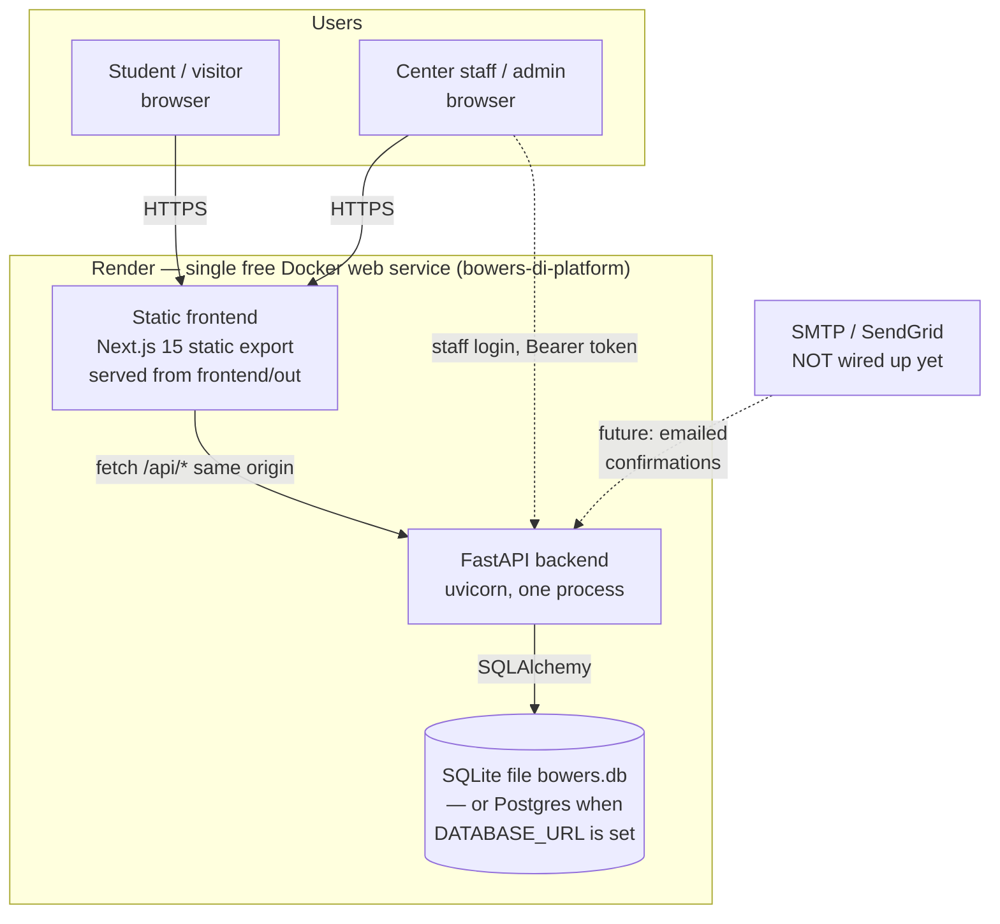

# Bowers D&I Platform — Architecture

The Center for Belonging's working tool at Cornell CIS Bowers: it surfaces
the Center's real resources to underrepresented students, tracks conference
participation, runs an opt-in newsletter, and takes appointment requests for
Dr. LeeAnn Roberts. Full product spec: `REAL-SPEC.md`. Deploy notes:
`DEPLOY_NOTES.md`.

## System diagram



ASCII version (same boxes and arrows):

```
  Student browser ──┐
                    │  HTTPS
  Staff browser ────┘
                    ▼
  ┌─────────────────────────────────────────────────┐
  │ Render — one Docker web service                 │
  │                                                 │
  │  Next.js static export (frontend/out)           │
  │        │ fetch /api/* (same origin)             │
  │        ▼                                        │
  │  FastAPI (uvicorn) ──SQLAlchemy──► SQLite file  │
  │        │                             (or        │
  │        └─ future ──► SMTP/SendGrid  Postgres    │
  │                       (not wired)   via         │
  │                                     DATABASE_URL)│
  └─────────────────────────────────────────────────┘
```

## Components

| Component | What it does | Why it was chosen |
|---|---|---|
| **Frontend** — Next.js 15 + React 19 + TypeScript, `output: "export"` | All pages are client components that fetch the API at runtime: Home, Resources, Conferences, Programs, Newsletter, Appointments, Dashboard, Login/Register. Static export means the backend can serve it with no second server. | The chat's settled stack (Next.js + TS). Static export keeps the deploy to one free service and makes the frontend trivially cacheable. |
| **Backend** — FastAPI + SQLAlchemy, Python 3.12 | One process serves the API (`/api/*`) and the built frontend (SPA fallback for non-`/api` paths). Endpoints: health, auth, resources, conferences + participation, events, newsletter double opt-in, appointments, outreach, dashboard, reports summary. | The chat's settled stack (FastAPI + PostgreSQL). FastAPI's validation and OpenAPI docs fit a small staff tool; SQLAlchemy keeps the Postgres/SQLite switch to one env var. |
| **Database** — SQLite by default, Postgres when `DATABASE_URL` is set | Tables: users, session tokens, resources, conferences, conference participation, events, newsletter subscribers, appointments, outreach entries. | SQLite is zero-setup for local verification and for the free Render deploy (Render allows one free Postgres per workspace and it is already used by another project). Postgres is the production shape; the same models run on both. For persistent multi-user data, set `DATABASE_URL` to a Neon Postgres URL. Container SQLite storage is ephemeral. |
| **Auth** — stdlib only | Passwords: `hashlib.pbkdf2_hmac` + per-user salt. Sessions: `secrets.token_urlsafe` tokens in the DB, 7-day expiry, Bearer header. Roles: student / faculty / admin. Registration always creates `student`; an admin promotes roles. | No extra dependencies, no secrets in code, and the role model matches the chat's multi-role requirement while the login method (NetID/SSO vs email) is still an open question. |
| **Newsletter** — double opt-in, no SMTP yet | Signup returns a confirmation token + URL, shown on the confirmation page; confirm endpoint activates the subscriber; unsubscribe by email. | There is no mail server in this environment. Showing the link keeps the flow testable end-to-end today; wiring SendGrid/SMTP is a one-endpoint change (see DEPLOY_NOTES.md). Audience is opt-in only by design — no org-roster imports without permission. |
| **Dashboard / reporting** — computed, never fabricated | Totals, participation by conference, outreach by month, subscriber growth, appointments by status — all aggregated from real DB rows. Charts are hand-rolled SVG (no chart dependency). | The chat requires participation-trend charts and leadership reporting. Charting only real rows means an empty dashboard is honest: participation is tracked going forward only. |

## Data model

- **User** — id, name, email (unique), password hash + salt, role, created_at.
- **SessionToken** — token, user_id, expires_at.
- **Resource** — id, title, description, category (Office services / Community resources / Campus partners), audience, link (outbound, real URLs only).
- **Conference** — id, name, date (nullable), end_date (nullable), location, status (upcoming / past / cancelled / tba), description, link, attendees (aggregate, nullable).
- **ConferenceParticipation** — id, conference_id, user_id (nullable), note, created_at. A logged-in user records their own attendance; an admin can record for someone else.
- **Event** — id, name, description, date (nullable — dates are only stored when known), status, category (program / conference / workshop / community), location (nullable).
- **NewsletterSubscriber** — id, name, email (unique), interests, topics, source, status (pending / confirmed / unsubscribed), confirmation_token, created_at.
- **Appointment** — id, name, email, topic, preferred_date/time (nullable), notes, status (pending / confirmed / declined / completed), created_at. Requests go to the office for confirmation; no calendar times are invented.
- **OutreachEntry** — id, date, program, channel, audience, contacts_reached, subject, notes.

Seed data (see `backend/app/seed.py`) is real content only, from
`REAL-SPEC.md` §7.1: 25 resources, 5 conferences, 10 events, one demo
admin. No participation, subscriber, appointment, or outreach rows are
seeded.

## Request flow

1. Browser loads the static page from the backend (same origin, so API
   calls need no CORS in production; localhost dev uses CORS for :3000).
2. Pages fetch `/api/resources`, `/api/conferences`, `/api/events`
   (public, no login) and render.
3. Signup / appointment forms POST publicly; newsletter signup returns a
   confirmation URL the page displays.
4. Login returns a Bearer token (localStorage). Staff pages call
   `/api/dashboard`, `/api/appointments`, `/api/reports/summary` with it;
   the backend enforces roles (401 unauthenticated, 403 non-admin).

## Design decisions

See README.md "Design Decisions". Headlines: Cornell Bowers visual
identity (carnelian `#B31B1B`, navy `#000056`, light gray `#F7F7F7`);
single-service deploy to stay on Render's free tier; SQLite default with
a Postgres escape hatch; opt-in-only newsletter; no invented content
anywhere — every resource, conference, and program is traceable to the
Bowers pages or jem's own words in `REAL-SPEC.md`.

## How it scales

- **More traffic:** the frontend is static and cacheable; the API is
  stateless apart from the DB, so the web service can scale horizontally
  once the DB moves to Postgres.
- **More data:** participation, subscribers, and appointments are plain
  rows; dashboard aggregations are simple GROUP BYs. If they ever get
  slow, add indexes on the foreign keys and pre-aggregate monthly counts.
- **Real email:** add an SMTP/SendGrid send in the newsletter signup
  endpoint; the token flow already exists.
- **Real login:** replace the email/password + role-promotion flow with
  Cornell NetID/SSO or an email allowlist when the Center decides (open
  question — see DEPLOY_NOTES.md).
- **What it is not:** this is a staff tool for one office, not a
  multi-tenant product. No sharding, no cache layer, no background jobs
  are needed at this scale; adding them would be impressiveness over
  real users.
